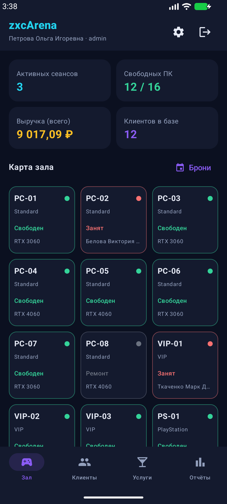
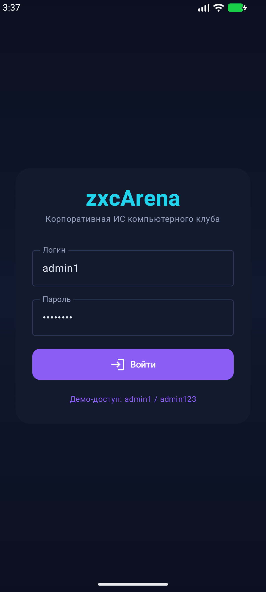
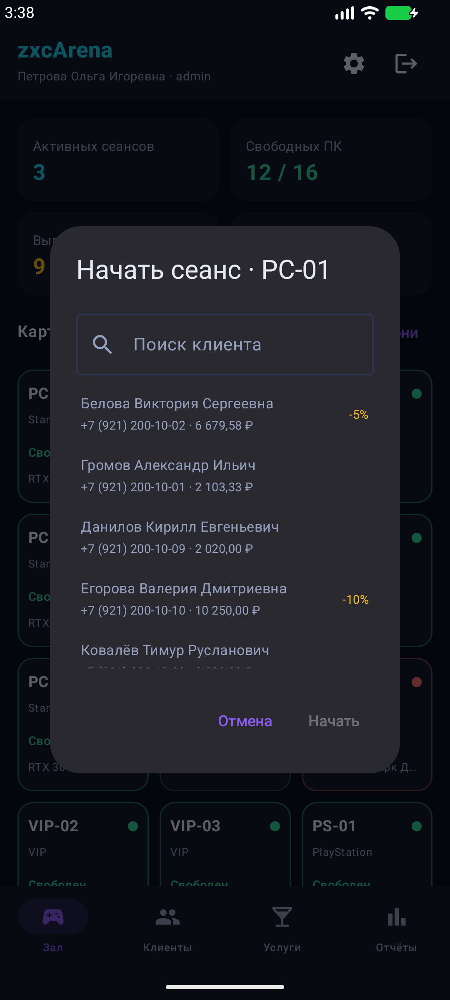
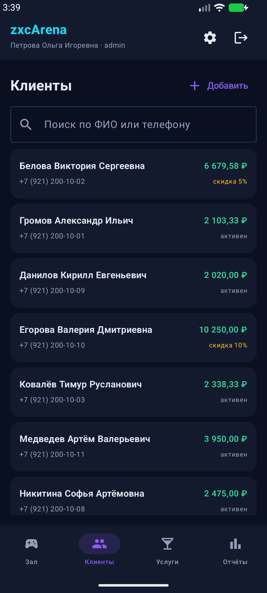
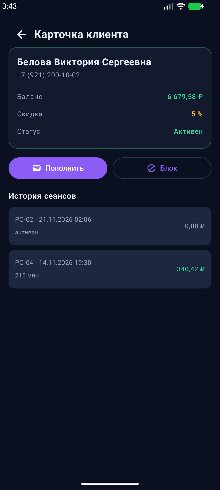
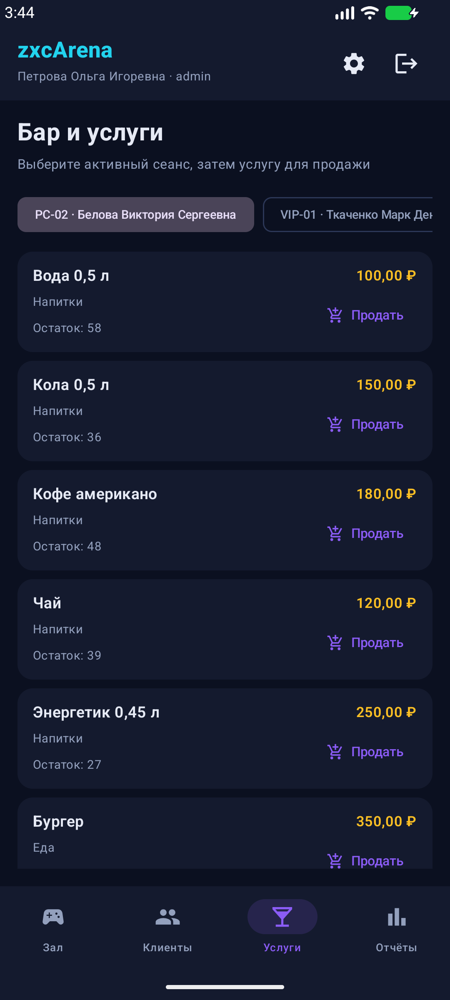
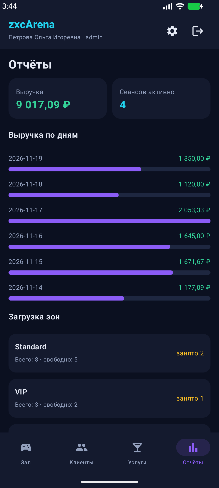

# 🎮 zxcArena — КИС компьютерного клуба

**Мобильное приложение для автоматизации компьютерного клуба:** карта зала, игровые сеансы, баланс клиентов, бар и прокат, бронирование, отчёты и обмен данными.




---

## 📌 О проекте

**zxcArena** — учебный проект корпоративной информационной системы компьютерного клуба. Приложение заменяет бумажный журнал администратора: показывает занятость рабочих мест, считает стоимость сеанса по тарифу и скидке, ведёт баланс клиентов, продаёт услуги бара и проката, оформляет брони и строит отчёты.

Всё работает **локально на устройстве** — без сервера и интернета. Данные хранятся в SQLite, целостность обеспечивается ограничениями, транзакциями и триггерами. Для обмена с центральной базой клуба предусмотрен экспорт и импорт JSON.

Проект выполнен в рамках курсовой работы по дисциплине «Разработка корпоративных информационных систем». Тема — «Разработка мобильного приложения корпоративной информационной системы „Компьютерный клуб“».

---

## 🧰 Стек разработки

| Слой | Технологии |
| --- | --- |
| Язык | Kotlin 2.0 |
| Интерфейс | Jetpack Compose, Material 3, тёмная тема |
| Архитектура | MVVM: Compose → ViewModel → Repository → SQLite |
| База данных | SQLite 3, `SQLiteOpenHelper`, чистый SQL |
| Целостность | 10 таблиц, 12 триггеров, 6 представлений, транзакции, `FOREIGN KEY`, `CHECK`, индексы |
| Сборка | Android Studio, Gradle 8.9, AGP 8.7.3 |
| Платформа | Android 7.0+ (minSdk 24), targetSdk 35 |
| Диаграммы | PlantUML, Graphviz (нотация Чена) |

---

## ✨ Функционал

- 🔐 **Авторизация сотрудников** — логин и пароль, хранение паролей в виде SHA-256, роли администратора, менеджера и техника.
- 🗺 **Карта зала** — 16 рабочих мест в четырёх зонах, цветовые статусы («свободен», «занят», «ремонт»), сводные показатели по сеансам, свободным ПК и выручке.
- ▶️ **Игровые сеансы** — запуск с поиском клиента, автоматический расчёт стоимости по дневному/ночному тарифу и скидке, завершение со списанием баланса.
- 👥 **Клиенты** — поиск по ФИО и телефону, карточка с историей сеансов, пополнение баланса, блокировка и разблокировка.
- 🥤 **Бар и прокат** — продажа услуги в рамках активного сеанса, контроль остатков и списание с баланса.
- 📅 **Бронирование** — список броней и оформление новой с проверкой пересечения по времени.
- 📊 **Отчёты** — выручка по дням, загрузка зон, топ услуг.
- 🔄 **Обмен данными** — экспорт и импорт JSON, сброс демонстрационных данных.
- 🛡 **Защита от ошибок** — запрет двух сеансов на одном ПК, отрицательного баланса, продажи отсутствующего товара и конфликтующих броней.

---

## 🗄 База данных

| Таблица | Назначение |
| --- | --- |
| `zones` | Зоны клуба |
| `tariffs` | Дневные и ночные тарифы |
| `computers` | Рабочие места и их статусы |
| `clients` | Клиенты, баланс, скидки |
| `employees` | Сотрудники и хеши паролей |
| `sessions` | Игровые сеансы и стоимость |
| `services` | Услуги бара и проката |
| `service_orders` | Заказы услуг в рамках сеанса |
| `payments` | Пополнения и возвраты |
| `reservations` | Бронирования |

Триггеры автоматически пересчитывают стоимость сеанса, меняют баланс, уменьшают остатки, синхронизируют статус ПК и блокируют конфликтующие операции. Представления (`v_active_sessions`, `v_daily_revenue`, `v_zone_load` и другие) используются для карты зала и отчётов.

---

## 📱 Скриншоты

<table>
  <tr>
    <td align="center"><br><sub>Авторизация</sub></td>
    <td align="center"><br><sub>Запуск сеанса</sub></td>
    <td align="center"><br><sub>Клиенты</sub></td>
  </tr>
  <tr>
    <td align="center"><br><sub>Карточка клиента</sub></td>
    <td align="center"><br><sub>Бар и услуги</sub></td>
    <td align="center"><br><sub>Отчёты</sub></td>
  </tr>
</table>

---

## 🚀 Установка

1. Скопируйте `apk/zxcArena.apk` на устройство с Android 7.0 или новее.
2. Разрешите установку из неизвестных источников и установите APK.
3. Откройте приложение и войдите под демонстрационной учётной записью.

| Роль | Логин | Пароль |
| --- | --- | --- |
| Администратор | `admin1` | `admin123` |
| Управляющий | `manager1` | `manager123` |
| Техник | `tech1` | `tech123` |

При первом запуске база создаётся автоматически и заполняется демонстрационными данными: 16 рабочих мест, 12 клиентов, 12 услуг, сеансы, платежи и брони. Сбросить данные можно в разделе «Настройки».

---

## 📂 Структура папки

```
zxcArena/
├─ README.md                 этот файл
├─ apk/
│  └─ zxcArena.apk           готовое приложение
├─ code/
│  └─ zxcArena_source.zip    исходный проект Android Studio
├─ screenshots/               скриншоты экранов
└─ video/
   └─ zxcArena_demo.mp4      запись работы приложения
```

В архиве с исходниками: `android/` (проект), `db/` (SQL-скрипты), `diagrams/` (UML и ER-диаграммы). Проект открывается в Android Studio (JDK 17) и собирается командой `./gradlew assembleDebug`.

---

## 🎬 Видео

`video/zxcArena_demo.mp4` — запись работы приложения: вход, карта зала, запуск и завершение сеанса, клиенты и баланс, продажа услуг, брони, отчёты и выход из системы.

---

## 📝 Примечание

Проект учебный: данные, имена клиентов и телефоны вымышлены, приложение не подключено к реальным платёжным системам. Пароли сотрудников в демонстрационной базе — тестовые.
